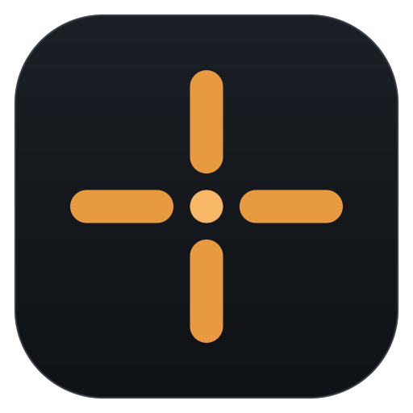

<p align="center">
  
</p>

<h1 align="center">Crosshair Overlay</h1>

<p align="center">
  Внешний статичный прицел для Windows в стиле CS2.<br>
  Отдельное прозрачное окно поверх игры, без внедрения в процесс и чтения памяти.
</p>

> **Вайб-код проект.** Большая часть кода и документации создана с помощью ИИ и затем проверена вручную.

## Возможности

- 10 стилей прицела CS2, цвета и обводка.
- Настройка длины, толщины и зазора; смещение относительно центра окна.
- Масштабирование под высоту активного окна.
- Импорт и экспорт share code CS2 и legacy CS:GO/CS2.
- Горячая клавиша `Ctrl+Alt+X`.
- Сворачивание окна в системный трей при закрытии.
- Автозапуск при входе в Windows.
- Установщик с выбором папки, ярлыком в меню «Пуск», ярлыком на рабочем столе и деинсталлятором.
- Портативная сборка без установки.

## Скачать и установить

Скачайте файлы из раздела [Releases](../../releases/latest):

- `CrosshairOverlay-Setup-<version>.exe` — установщик;
- `CrosshairOverlay-<version>-portable.zip` — портативная версия;
- `SHA256SUMS.txt` — контрольные суммы.

Установщик позволяет выбрать папку, создаёт ярлык в меню «Пуск», по желанию добавляет ярлык на рабочий стол и автозапуск. Удаление — через «Параметры → Приложения» или ярлык деинсталлятора в меню «Пуск».

Сборки не подписаны сертификатом. Windows SmartScreen может показать предупреждение: «Подробнее» → «Выполнить в любом случае». Сверяйте SHA-256 с `SHA256SUMS.txt`.

Для портативной версии распакуйте архив и запустите `crosshair-overlay.exe`. Если нужен автозапуск, сначала переместите exe в постоянную папку.

## Использование

1. Запустите игру в оконном или безрамочном режиме.
2. Запустите Crosshair Overlay и настройте прицел.
3. Сверните настройки или переключитесь в игру.
4. Включайте и выключайте прицел сочетанием `Ctrl+Alt+X`.

Кнопка закрытия окна сворачивает приложение в трей, а не завершает его. Открыть настройки снова можно из меню значка в трее, полностью выйти — через пункт «Выход» в том же меню или кнопку «Выход» в приложении.

Оверлей скрывается, когда активно окно настроек. Позиция привязывается к центру клиентской области активного окна.

## Требования

- Windows 10 или 11, x64.
- Оконный или безрамочный режим игры. Эксклюзивный полноэкранный режим не поддерживается.
- Для работы горячей клавиши приложение должно быть запущено.

## Настройки и журнал

- Конфигурация: `%APPDATA%\CrosshairOverlay\config.json`
- Журнал: `%APPDATA%\CrosshairOverlay\overlay.log`

Настройки сохраняются автоматически. При удалении приложения конфигурация сохраняется.

## Сборка

### Windows

Нужны Rust stable, Visual Studio Build Tools с Windows SDK и NSIS.

```powershell
rustup default stable
cargo test
cargo build --release
```

Для exe-ресурсов build.rs использует `rc.exe` из Windows SDK. Иконка и версия встраиваются автоматически. Релизная MSVC-сборка использует статический CRT и не требует установленного Visual C++ Redistributable.

Полная сборка установщика и портативного архива:

```powershell
choco install nsis
.\scripts\build-release.ps1
```

Результаты появятся в `dist/`. Для пропуска тестов: `.\scripts\build-release.ps1 -SkipTests`.

### Linux

Кросс-сборка использует [cargo-zigbuild](https://github.com/rust-cross/cargo-zigbuild) и Zig:

```bash
rustup target add x86_64-pc-windows-gnu
cargo install cargo-zigbuild
cargo zigbuild --release --target x86_64-pc-windows-gnu
```

Для встраивания иконки build.rs вызывает `zig rc`; Zig должен быть в `PATH` или задан через `ZIG`. Для установщика нужен `makensis`.

```bash
scripts/build-release.sh
```

Скрипт собирает exe, портативный zip, установщик и `SHA256SUMS.txt` в `dist/`.

### Иконка

Иконка генерируется без внешних зависимостей:

```bash
python3 scripts/generate-icon.py
```

## Публикация и релиз

Первый пуш в пустой репозиторий GitHub:

```bash
git init
git add .
git commit -m "Initial release"
git branch -M main
git remote add origin https://github.com/USERNAME/crosshair-overlay.git
git push -u origin main
```

Для релиза:

1. Обновите версию в `Cargo.toml`; `Cargo.lock` обновится при следующей сборке.
2. Закоммитьте изменения и создайте тег с той же версией:

```bash
cargo check
git add Cargo.toml Cargo.lock
git commit -m "Release v0.1.0"
git tag v0.1.0
git push origin main --tags
```

Workflow `.github/workflows/release.yml` соберёт exe, установщик, портативный архив и опубликует их в GitHub Releases. Ручной запуск через `workflow_dispatch` создаёт только артефакты без релиза.

## Структура проекта

```text
src/
  app.rs          интерфейс настроек
  overlay.rs      Direct2D-оверлей
  geometry.rs     геометрия прицела
  config.rs       конфигурация и валидация
  sharecode.rs    CS2/legacy share code
  autostart.rs    автозапуск Windows
  shared.rs       состояние UI и оверлея
installer/        NSIS-установщик
scripts/          сборка релиза и иконки
assets/           иконки приложения
.github/          CI и release workflow
```

## Ограничения

- Динамический разброс, отдача и shot feedback не анимируются: приложение не читает память игры.
- Оверлей может не работать в играх с эксклюзивным полноэкранным режимом.
- Сторонние оверлеи могут нарушать правила отдельных игр и античит-систем. Используйте приложение на свой риск.
- Проект не связан с Valve, Counter-Strike, Faceit или другими играми и сервисами.

## Лицензия

MIT. См. [LICENSE](LICENSE).
